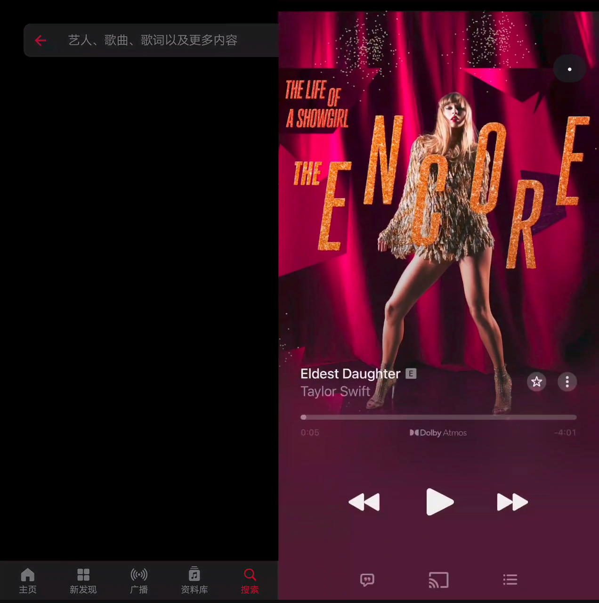
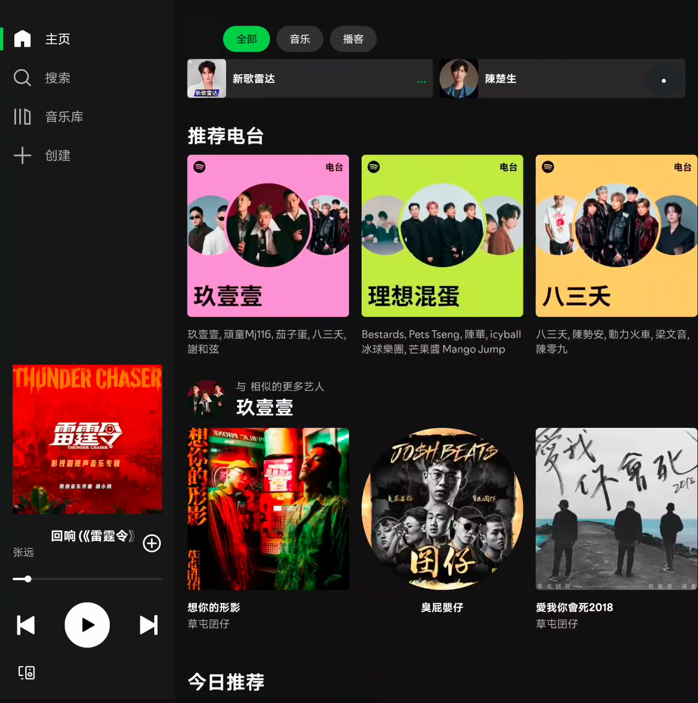

# CarLinkLab · 车机互联实验室

NIO Phone（Android 14 / SkyUI）× NIO ET5T 的互联实验记录：NIO Link 应用白名单、显示与触摸机制、CarPlay 接收实验，以及确认失败的路径。

本公开版发布技术文档、55 条白名单配置和实验脚本。**不包含可安装应用或完整应用源码**。原始实验记录截至 2026-10-11，公开版整理于 2026-10-19；结论受设备、系统和应用版本限制。

## 模拟画面预览

以下是历史桌面/虚拟画布模拟截图，已遮挡搜索历史及头像。**不是车机实拍，不代表当前稳定性、性能或全部功能已通过实车验收。**

| Apple Music 双栏布局 | Spotify 大画布布局 |
|---|---|
|  |  |

[输入法模拟及图片说明](assets/previews/README.md)

## 先看当前结论

- **NioPlay / CarPlay**：已完成实车验证；这里仅提供记录，不分发接收端 APK、认证材料或完整源码。
- **Android Auto 单机自投影**：本机 AA 17.7 与 17.3 分别受禁用组件、CDM 特权权限限制，路线已终止。
- **NIO Link 跨端入口**：由包名白名单等条件控制；普通应用无法通过现有非 root 通道直接修改名单。白名单包名占位不等于修改系统白名单，也存在应用冲突风险。
- **AM 助手**：原生 Apple Music / Spotify 画面、触摸和播放已获实车确认。Wi-Fi 下重启后保留配对恢复已验证；移动网络下冷启动、连续 24 小时与长期保活尚未完成验证。后续 4.10.6 提高分辨率与帧率上限，但曾黑屏需重连，黑边问题未解决；不能当作稳定完成版。完整助手源码和安装包未随本版发布。
- **横屏存在前提**：`wm user-rotation` 对被 SkyLink 判为 `user` 的应用有用，不能保证任意应用横屏，也不能据此承诺跨系统版本永久生效。禁止事后用 `wm size` 改车机显示器尺寸，曾出现触摸错位。
- **旧实验已终止**：`tools/car-orientation-test.sh` 跑错显示器且相关启动被系统拦截，现已阻止执行。

先读 [当前结论与适用边界](docs/PUBLICATION-NOTES.md)，再查历史笔记。历史中的“待验证”“下一步”和本地路径不代表现在可直接执行。

## 白名单数据

| 文件 | 内容 |
|---|---|
| [nio_link_whitelist.csv](data/nio_link_whitelist.csv) | 45 个应用 + 10 个游戏；已移除个人手机的安装状态列 |
| [settings_config.json](data/settings_config.json) | 实验时提取的配置快照，`ver=20260114`；不是在线服务或持续更新的官方名单 |
| [白名单与触发机制](docs/NIO-Link白名单与触发机制.md) | 字段、版本差异和触发条件 |

关键字段：`pkgName` 为包名，`minVer` 为最低版本条件，`bizType` 为业务分组。`screenType` 的完整语义尚未确定，不能把所有值当成已证实的布局枚举。请用 `pm path` 确认设备实际生效的 APK；系统分区旧版与更新版的名单可能不同。

## 文档与工具

- [实车验证与性能边界](docs/VERIFICATION.md)
- [完整文档索引](docs/README.md)
- [项目上下文与成果备忘](docs/项目上下文与成果备忘.md)：机制、证据与死路清单
- [技术原理及开发路线](docs/天空视窗与NIO-Link技术原理及开发路线-20261008.md)
- [AM 助手单应用自动桥接记录](docs/log/AM助手-单应用自动桥接-20261011.md)
- [工具清单与依赖边界](tools/README.md)：先确认依赖，再按需使用

脚本未经统一封装。Python 3、ADB、Node.js 是常见依赖；部分工具另需 Android SDK、JDK、scrcpy，或本仓库未发布的助手及桥接文件。**能通过语法检查不等于已在你的设备运行验证。** 指定设备可用 `NIO_DEV` 的工具应设置 `NIO_DEV='你的序列号'`；其余脚本依照各自说明选择设备。

仅在停车并确保安全时调试。先记录显示参数和设备状态，阅读脚本及回滚步骤；不要在行车中操作。

## 发布范围与许可

未收录 APK、密钥、MFI 认证资产、厂商反编译产物、原始设备日志、逐时操作笔记、私人网络信息或录屏。图片仅含上面三张经脱敏的模拟预览。文档引用的 `apps/`、`tmp/`、`apk/`、`archive/` 和采集数据路径，多数仅存在于原实验环境。

原创代码与脚本采用 [MIT](LICENSE)；原创文档与整理数据采用 [CC BY 4.0](https://creativecommons.org/licenses/by/4.0/deed.zh)。第三方商标及配置所引用的图标不因本仓库许可而获得额外授权。项目与 NIO、Apple、Google 无隶属或背书关系。

使用前阅读 [免责声明](DISCLAIMER.md)。发现过时结论、复现差异或脱敏遗漏，请提交 Issue，附设备和版本信息；请勿上传密钥、账号信息或未经脱敏的日志。
