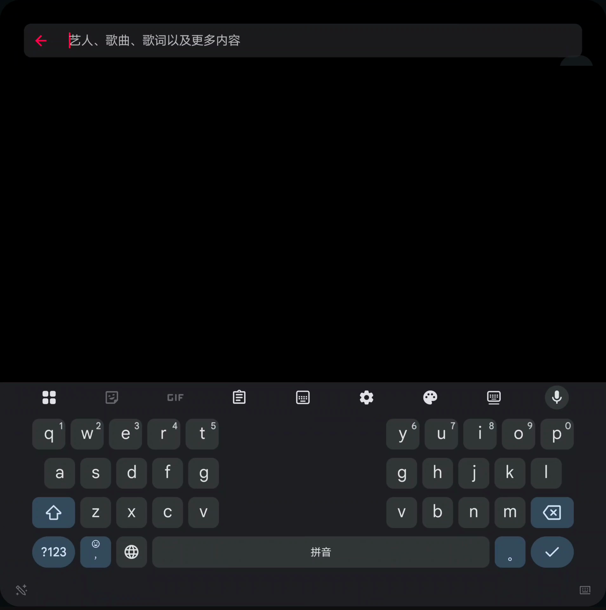

# 桌面模拟预览

这三张图片来自历史桌面/虚拟画布布局测试，**不是车机截图或车内实拍**，也不是 AI 重绘。

仅进行了实心遮挡和去除图片元数据：Apple Music 搜索记录、Spotify 头像已遮挡。未修改应用布局、封面、控件或尺寸比例。歌曲与专辑仅作为测试画面内容，不代表任何厂商对项目的认可。

图片不能证明车机显示比例、实际触摸映射、音质、性能或长期稳定性。尤其不要把方形模拟画布理解为车机必然具有相同的物理比例。

## Apple Music 双栏布局

## Spotify 大画布布局

## 输入法布局

应用界面、商标及专辑图片属于各自权利人；这些第三方视觉内容不适用本仓库原创代码的 MIT 授权。
