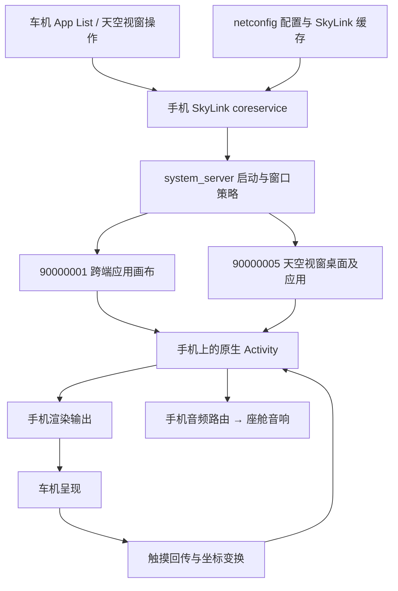

> 公开版校订（2026-10-19）：本文保留实验过程，历史“下一步”和本地路径不代表当前可用步骤。请先读 [当前结论与适用边界](PUBLICATION-NOTES.md)。

# 天空视窗与 NIO Link：技术原理、接入边界与开发路线

研究日期：2026-10-08。对象：本项目 NIO Phone N2301 / Android 14 / SkyUI × ET5T。本文综合公开一手资料、本地系统反编译与已有实验记录；未连接车机补做实验，未安装或修改应用。

## 1. 开发结论

天空视窗的应用仍运行在手机上。手机的 SkyLink 系统服务和定制 Android 框架管理额外显示器，车机负责呈现和交互；NIO Link 是覆盖应用流转、音频与其他跨端功能的互联体系。不能把它简单等同于手机默认屏幕截图，也不能把应用流转理解为把 APK 安装到车机执行。

后续开发必须分别解决三个问题：**车机入口是否接受这个包、Activity 实际在哪块显示器及窗口运行、应用是否在该窗口选择合适的布局**。音频路由和 DRM 是另外的验收项。一个条件成功不能证明其余条件成功。

本机无 root，也没有已验证可供普通自签名应用调用的 NIO 特权接入接口。目前值得推进的是：

1. 验收已存在的白名单壳与独立虚拟屏桥接，将原生应用画面放进壳中；本项目已完成手机端原型，车内尚待验证。
2. 对自己控制的 Activity 做多显示器、横屏、触摸和生命周期适配，使用系统正常流转入口。
3. 原生第三方包直接获得跨端待遇，长期需要厂商配置支持；尚无已验证的免 root 通用旁路。

不能承诺“任意原版 APK 一键原生流转且无损、无额外进程、永久离线自启动”。现有证据不支持这样的产品能力。

## 2. 证据等级与版本边界

| 标记 | 含义 | 使用方式 |
|---|---|---|
| 官方公开 | 蔚来、Android 官方文档、开源项目自身文档 | 说明产品能力或标准行为，不能替代本机验证 |
| 源码核对 | 本地 APK / JAR 的 smali、dex 反汇编 | 证明当前资产中存在的分支，不保证调用路径或最终车机行为 |
| 已有实测 | 仓库日志、截图、窗口快照和实验报告 | 仅覆盖对应版本、场景和时间段 |
| 推断 / 待验 | 从以上证据提出的解释或开发方案 | 必须给出验证判据 |

历史文档存在矛盾，本文优先采用《未落文档的结论-补充记录》《AppList调用链复核》以及 10 月 8 日的虚拟屏实验。截图只能证明对应手机或模拟显示器画面；不能冒充车机截图。显示器数字属于当前 ROM 的实现，开发应发现并记录实时实例，不能只靠数字判断状态。

## 3. 公开产品资料能确认什么

蔚来 2023 年的官方使用指南要求同账号、激活车辆钥匙、蓝牙与 WLAN 开启；天空视窗支持访问手机应用、横屏和座舱扬声器。指南把近场链路写作“5G 无线连接”，结合 WLAN 场景应理解为近场无线描述，不能据此认定走蜂窝 5G，亦不能单凭此页确定 Wi-Fi Direct、信道、编码器或传输协议。该页同一版本对摄像头功能还有前后不一致描述，因此不把它当作本机摄像头、锁屏策略或性能参数的现行规范。[蔚来官方使用指南](https://phone.nio.com/niolink-guide/how-to-use-nio-phone-in-the-vehicle-centeral-control-screen)

本轮检索 `NIO Link / 天空视窗 / SDK / 开发者`，未找到可直接用于普通第三方应用的公开天空视窗接入规范；“未找到”不等于厂商没有合作伙伴 SDK。公开开发者站介绍的是 Open NSC 服务云，不能把它当作天空视窗 SDK。[蔚来开发者平台](https://developer.nio.com/)

## 4. 系统架构与两条显示路径



图展示已知职责，未声称已经还原 NIO 视频传输的完整协议。控制消息已有 databus protobuf 证据，媒体数据面的编码、码率和加密仍未完整确认。

| 实例 | 已知作用 | 开发含义 |
|---|---|---|
| `90000005` / `com.nio.link.connly.five` | 天空视窗桌面路径；NioPlay CarPlayHostActivity 也在此运行 | 不是必然竖屏，也不是只能逐像素镜像默认手机屏 |
| `90000001` / connly.one | 正常跨端应用启动链使用的画布 | 原生第三方包启动受系统策略约束 |
| 独立实验虚拟屏，例如 13 / 14 | scrcpy 创建，运行 AM，由壳显示其视频 | 与 NIO 两块屏不是同一权限和策略环境 |

已有日志证明 NioPlay 在 90000005 上达到 `3024×1696` 横屏窗口；YouTube 后来在 90000001 创建会话。因此“先拿到 90000001 才能横屏”不成立。入口、窗口形态与几何分别观察。[本地纠错与日志索引](log/未落文档的结论-补充.md#2-nioplay-的真实落点2045-新查实文档全无记载)

## 5. 正常应用流转调用链

手机 SkyLink 从配置和安装状态组装应用列表，车机从列表选择应用，再由系统服务执行跨屏启动：

```text
配置 supportPkgList + 已安装应用
  → DistributeAppProp.supportPkgList
  → 车机 App List
  → SkyLink CastHandlerMessage
  → remoteapi/b.e(pkg, activity, uid)
  → msg_auto_matic_sync_app_info
  → SubFullScreenState.startCastInit
  → judgeCreateVirtualDisplay
  → ContextUtil.startCastActivity
  → system_server.shouldAbortActivityStart
  → 目标 Activity / 显示器
```

证据：`tmp/skylink/dec/smali_classes2/n0/v.smali` 的 `I()`；`com/ucarmd/utils/b$a.smali:167`；`remoteapi/mode/j.smali:339`；`remoteapi/b.smali:110` 起及 `:238` 消息名。更完整说明见 AppList 调用链复核（原始记录留本地；见[公开验证摘要](VERIFICATION.md)）。

**被系统启动不等于应用获得主动调用系统流转接口的权限。** 包名进入配置，也不等于能 bind SkyLink service、写配置或移走另一个应用。

标准 Android 的 `ActivityOptions.setLaunchDisplayId()` 只表达启动目标；访问私有显示器还有平台限制，SkyUI 又增加自己的启动拦截。指定 displayId 不构成授权。[Android ActivityOptions](https://developer.android.com/reference/android/app/ActivityOptions#setLaunchDisplayId(int))

## 6. 配置、白名单和权限：至少两层门槛

### 6.1 展示及支持配置

`supportPkgList` 分 `cross_dev_notify / cross_dev_app / cross_dev_game / free_window`；条目包括 `pkgName / minVer / screenType / type / immersive / support_min_window / appName / appIcon`。内置资产和运行时下发缓存数量不同，旧记录中的 45 个应用不能当作所有车辆、版本的固定名单。

条目未见强制第三方集成 SDK 的代码契约，这支持“系统可以流转未经专门改造的应用”，不支持“所有名单应用都从未做过合作适配”。包名是重要匹配键；版本条件应按匹配方法具体核实，配置存在 `minVer` 不足以单独证明比较符号。实验包应满足已记录下限，再核对系统实际接受结果。

### 6.2 框架启动策略

`ScreenCastConfigManager.dealScreenCastConfig(Bundle)` 读 `package_list_white` 等配置，经回调刷新 `ScreenCastControllerSkyImpl.mLinkDisplayPackage`。`shouldAbortActivityStart` 在跨屏启动时执行，另有登录特例、组件排除、保留窗口和允许启动目标等名单。不能把整个策略简化成一条白名单判断。

`isInAllowStartOtherAppsList(sourceApp, targetApp, targetComponentName)` 最后查询的是 **targetApp**。此前把它解释成“允许 13 个 caller 发起启动”的记录已被复核纠正；VidHub → AM 的已测路径仍被 code=102 拒绝。证据：`tmp/skyui-framework/ScreenCastControllerSkyImpl.asm.txt:6934`，以及 调用链复核（原始记录留本地；见[公开验证摘要](VERIFICATION.md)）。

### 6.3 权限边界

配置由 netconfig 系统应用提供，SkyLink 缓存位于私有目录，普通 shell 读取配置 Provider 被拒；`run-as`、`su`、`adb root` 已失败。SkyLink 的 `cast_screen` Provider 和 `NioLinkService` 受 `com.skylink.coreservice.permission` 保护，本机记录为 `signature|knownSigner`。

`remote` Provider 所需 `com.nio.link.permission.CALL_NIO_LINK` 在较晚复核中未找到权限声明，不能沿用旧文档“所有入口都已证明相同保护级别”的说法。现有 query 被拒，仍不足以称其为普通应用公共接口。权限复核（原始记录留本地；见[公开验证摘要](VERIFICATION.md)）

白名单包名壳可能取得系统入口待遇，但未获签名权限。此前包含大量组件的替代包造成 NIO Link 闪退，**具体致因未证实**；无障碍、USB、自启组件只是排查线索。换 VidHub / 夸克包名也不是可靠修复结论。

## 7. windowType、方向与布局不能混用

### 7.1 windowType 属于车机控制消息

SkyLink 从 `CastScreenProto.ScreenInfo.getWindowType()` 读入状态；发送消息的部分路径回显该值。证据：`tmp/skylink/dec/smali_classes2/com/ucarmd/connectly/remoteapi/n.smali:2094`、`:2785`。当前项目将 2 / 6 对应为镜像形态 / 跨端形态，但这不是 Android 标准 windowingMode，也不是完整公开协议定义。

“只有 CarPlayHostActivity 能拿到 6”未在完整日志中复现，已降级；某条 launcher 的 6 不能证明应用也拿到 6。每次记录包、组件、displayId、时间，避免把不同会话拼成一个结论。[纠错证据](log/未落文档的结论-补充.md#1-纠正一条被广泛引用的错误结论)

### 7.2 本轮直接核对的枚举纠错

`SkyScreenCastOrientationManagerImpl.resolveAppOrientationIfNeed` 按输入的 Activity 方向判断，并改写 **`Configuration.orientation`**：固定竖屏写 1，固定横屏写 2。此次直接核对 `tmp/skyui-framework/classes.asm.txt:700771–700836`，可见 `iput ... Configuration.orientation`。

这里 **1 是 ORIENTATION_PORTRAIT，2 是 ORIENTATION_LANDSCAPE**。它不是 `ActivityInfo.SCREEN_ORIENTATION_USER=2`；同一个数字在两个枚举中意义不同。旧报告把这段写成“改为 user”不准确，不能据此推导必须配合用户旋转才能横屏。[Android Configuration 常量](https://developer.android.com/reference/android/content/res/Configuration#ORIENTATION_LANDSCAPE)

这段代码也不能单独解释 AM 的 `behind` 为什么最后竖屏，因为非固定方向分支不写值。AM 运行时方向、继承关系和其他窗口策略需要结合日志判断。SkyLink 另有 `forceRotation` / 冻结显示器旋转路径，公开旋转命令可能被持续覆盖。[本地源码与日志索引](NIO-Link-白名单闸门源码级证据.md)

### 7.3 实际资源条件

Android 应用按窗口可用尺寸、密度、方向和资源限定符选布局，横屏不自动等于平板模式。`w600dp` 与 `sw600dp` 也不是同一个条件。[Android 资源限定符](https://developer.android.com/guide/topics/resources/providing-resources#AlternativeResources)

本机 AM 6.5.2 / 1586 的 `bool/is_tablet` 默认 false，`sw600dp` 为 true。独立屏实测如下：

| 显示配置 | AM 实际窗口 / 资源条件 | 结论 |
|---|---|---|
| 3024×1696 / 450dpi | land，sw603dp | 横向平板条件成立；播放面板仍有封面裁切 |
| 3024×1696 / 600dpi | 居中竖屏 951×1696，sw254dp | 显示器横屏不证明 AM 横屏 |
| 3232×3248 / 600dpi | port，sw862dp | 大画布成立，但不是 16:9 |

证据：`data/reference-projects-20261008/am-tablet-resource.txt`、`data/am-virtual-display/` 与 [10 月 8 日实验报告](reference/联网参考项目与AM平板条件-20261008.md)。不要再用“横屏且宽度大于 600”替代真实最小宽度。

## 8. 画面、输入、音频与 DRM

NIO 画面链路的媒体编码参数尚未完全还原；目前能确认手机窗口/显示器和车机呈现之间存在系统管理的输出与输入关系。不要把实验桥接使用的 H.264 直接套到 NIO 原链路上。

输入必须保持窗口内容区域、编码尺寸、车机缩放和坐标变换一致。`wm size` 事后修改已有 NIO 屏曾被系统写回，并产生约 2.03× 输入偏差；已知坏路不应进入产品初始化流程。自控壳应按实际内容矩形换算触摸，单独验证上下左右、滚动、退出与重连。

90000005 含安全显示标志，本机 `screencap -d` 返回空，现有 uiautomator 不能读取车机画面。标准 secure virtual display 的含义是允许安全内容，并不等于所有平台上必然禁止任何截图；“截不了”是本机已测工具路径的结论。[Android DisplayManager](https://developer.android.com/reference/android/hardware/display/DisplayManager)

音频已有记录显示 AM 输出到 `nio_virtual_devices`，我确认座舱出声；PCM 路由记录支持未走蓝牙有损编码的解释，但不能独立证明每首音源、混音器、传输和 DSP 全链路 bit-perfect。报告不沿用“无损不需要任何额外条件”的绝对结论。CarPlay 的 AAC-LC 路径和 AM 安卓本地播放须分别判断。[项目音频记录 §4.7](项目上下文与成果备忘.md#47-音频链路与无损)

先播放再开天空视窗曾规避本机 DRM 19623；这是对应场景的成功顺序，不能推广成通用 DRM 绕过机制。验收至少包括新曲启动、切歌、暂停恢复、重连和路由变化。

## 9. 三种开发模式及现实限制

| 模式 | UI / 执行位置 | 已有能力 | 关键限制 |
|---|---|---|---|
| 自己的应用正常跨端 | 自控 Activity 在 NIO 显示器 | 多显示器适配可做 | 入口需被系统接受 |
| MediaSession 遥控壳 | 壳自绘 UI，AM 后台原生播放 | 元数据、封面、进度、部分控制已测 | 我曾否定旧自绘界面；资料库浏览被拒，队列切歌需逐项验 |
| 原生画面桥接壳 | AM 在独立虚拟屏，壳显示视频和转发触摸 | v4.4 / v4.5 手机端已连接、解码与操作 | 车内策略、USB拔线存活、延迟与音频未完整验收 |

MediaSessionManager 的普通第三方会话访问需要启用通知监听等受支持授权；它不是应用资料库浏览接口。AM 是否开放某个命令仍由会话决定，不能由“读到队列”推断“能任意切队列歌曲”。[Android MediaSessionManager](https://developer.android.com/reference/android/media/session/MediaSessionManager)

目前的原生桥接结构为：

```text
AM → 独立虚拟屏 → scrcpy server H.264
   → 手机回环桥接 → 壳 MediaCodec / TextureView → NIO 流转 → 车机
车机触摸 → 壳内容坐标换算 → scrcpy 控制协议 → AM
AM 音频 → 原生系统路由（桥接不捕获或重播音频）
```

这条路复用原生界面，而未把 AM 本身启动到 90000001；不应宣称已突破原生包白名单。额外编解码可能增加延迟、功耗和画质损失，需实测。控制协议、流元数据与帧头应跟随固定 server 版本实现。[scrcpy v5.0 协议文档](https://github.com/Genymobile/scrcpy/blob/v5.0/doc/develop.md)

shell 待命进程不是普通 APK 永久自启动能力。当前 v4.5 已提供手机开始/结束测试按钮，但需电脑预备，重启、超时或后台被杀后需重新准备。当前操作以 v4.5 入口说明（原始记录留本地；见[公开验证摘要](VERIFICATION.md)） 为准，不照旧交接重复安装或开启第二份服务。

## 10. 下一步验证顺序

### 第一优先：验收已有桥接，先决定是否值得产品化

使用当前已装版本，走 v4.5 手机入口和车机正常 App List 入口；一次只开一个画布。收集：

- 壳的包名、组件、displayId、windowType 来源、窗口大小、density、真实 sw/w/h 和方向。
- AM 独立屏、窗口配置、首帧/重连/断线日志，手机与壳控制动作时间标记。
- 四角点击、滚动、播放器、返回、暂停恢复；异常区分启动拦截、桥接死亡、解码和输入问题。
- USB 拔线后的进程存活，锁屏、最小化与恢复行为，连续运行温度和交互延迟。
- 座舱音频路由、切歌和 DRM；车机完整画面由物理拍摄补充。

通过条件应是“正常入口可进入、原生界面可操作、音频稳定、退出和重连可恢复”，而非只看一条 6 或一帧横屏图。若双重视频链路体验不可接受，再评估厂商接入或自控 UI；不要先扩大包名和组件试验。

### 第二优先：补齐机制证据，减少下轮误判

| 研究问题 | 最小验证方法 | 产出 |
|---|---|---|
| 版本门槛实际比较规则 | 读 getInstalledCastApps 及版本过滤调用链 | 比较符号、调用点、配置版本 |
| 配置推进 system_server 的完整发送端 | 查 package_list_white 构造与 Binder 调用方 | 从配置源到框架表的闭环 |
| windowType 2 / 6 与几何关系 | 同会话对应车机消息、目标组件和窗口快照 | 不混包、不混时刻的关联表 |
| AM behind 的实际方向来源 | 记录 requestedOrientation、配置及任务继承 | 找到最终竖屏分支 |
| 媒体链路参数与延迟 | 先定位编码器和数据面调用，再配合时间标记 | 编码参数及端到端时延，不猜协议 |

已有旋转开关可作为单变量实验，但必须保证目标 Activity 真正在对应屏上且原值能恢复。旧六组脚本启动失败不能单独证明每个开关都无效；同时这也不构成重新跑旧脚本的理由。

## 11. 不再投入的路径与纠错清单

- `tools/car-orientation-test.sh` 已作废：屏选错、shell 启动被拦、私有命令入口不可达。保留历史，不执行。
- `dumpsys window allPackagesFullscreen / transactinfo movePackageToDisplay` 等位于 `onCommand`，已查资产无调用方且分支要求 root；看到 dumpCommand 日志不是命令执行成功。
- 更换默认 launcher 不等于获得框架对系统 launcher 的特例资格。
- AA 在本机两条已测路径终止，不继续降级碰运气；root 在当前设备无已知可用解锁路径，不把它安排成近期前置。
- 复制 CarPlay Activity 属性不等于获得车机下发 windowType=6。
- `mPackageName` 和 `mPkgInSkyViewList` 是运行时状态，不是另两张静态白名单。
- 既有崩溃不能证明 VidHub 包名必坏，也不能证明某几个组件就是致因。
- 改最小宽度可能改变资源，但不保证 AM 封面、DRM或跨端资格一起解决。

这些纠错以本文为本次报告口径；历史文档尚未全部同步，不应拼接不同日期的“下一步”直接执行。

## 12. 参考与复查入口

公开资料检索日期均为 2026-10-08；网络资料用来解释标准与参考实现，具体 ROM 行为以本地证据为准。

- [蔚来：天空视窗官方指南](https://phone.nio.com/niolink-guide/how-to-use-nio-phone-in-the-vehicle-centeral-control-screen)：产品条件、显示与扬声器、早期无线描述。
- [Android ActivityOptions](https://developer.android.com/reference/android/app/ActivityOptions#setLaunchDisplayId(int))：多显示器启动目标与限制。
- [Android DisplayManager](https://developer.android.com/reference/android/hardware/display/DisplayManager)：虚拟显示器及安全显示标志。
- [Android Configuration](https://developer.android.com/reference/android/content/res/Configuration#ORIENTATION_LANDSCAPE)：配置方向枚举。
- [Android 资源规则](https://developer.android.com/guide/topics/resources/providing-resources#AlternativeResources)：布局限定符。
- [scrcpy v5.0 开发协议](https://github.com/Genymobile/scrcpy/blob/v5.0/doc/develop.md)：原生桥接的数据和控制协议。
- [本地：白名单闸门源码证据](NIO-Link-白名单闸门源码级证据.md)、AppList 调用复核（原始记录留本地；见[公开验证摘要](VERIFICATION.md)）、[未落结论及纠错](log/未落文档的结论-补充.md)。
- [本地：AM 虚拟屏实测](reference/联网参考项目与AM平板条件-20261008.md)、v4.4 桥接（原始记录留本地；见[公开验证摘要](VERIFICATION.md)）、v4.5 手机测试入口（原始记录留本地；见[公开验证摘要](VERIFICATION.md)）。

后续每次新增结论应附 ROM / APK 版本、时间、包及组件、displayId、复现入口、日志或图像位置，并明确“手机验证”还是“车内验证”。这比继续积累不带场景的开关列表更能支持开发决策。
